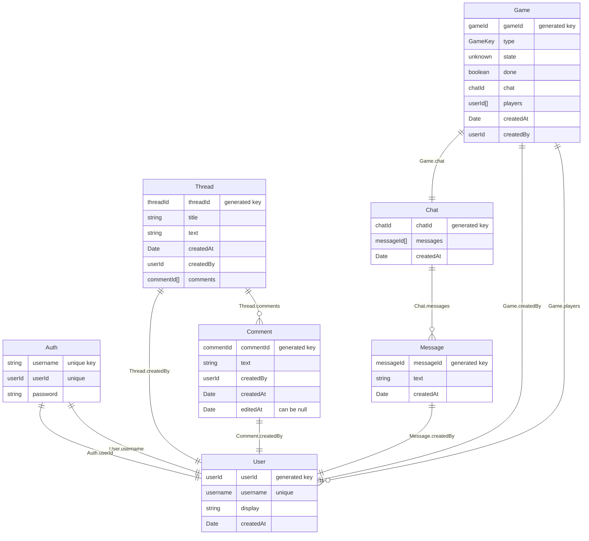

DEMO ON RENDER: https://spring26-project-spring26-project-group-hehn.onrender.com 
The individual and team project for this class are designed to mirror the
experiences of a software engineer joining a new development team: you will be
“onboarded” to our codebase, make several individual contributions, and then
form a team to propose, develop and implement new features. The codebase that
we'll be developing is GameNite, a website that answers the question "what if
Twitch, but for correspondence chess?"

You will get an opportunity to work with the starter code which provides basic
skeleton for the app and then additional features will be proposed and
implemented by you! All implementation will take place in the TypeScript
programming language, using React for the user interface.

## Features

The app includes (among other things):

- **Games** — Create and play Nim, Guess, and Hangman; in-game chat; game
  lists show the creator’s avatar next to recent activity (same pattern as
  forum posts).
- **Forum** — Threads and comments with author avatars and profile links.
- **Profiles** — Display name, optional bio, avatar gallery, profile
  visibility (public or friends-only), and optional social links (Twitter/X,
  Instagram, Discord) with URL validation.
- **Friends** — Send, accept, decline, or cancel friend requests; friends list
  with search; mutual friends on profiles; remove friends.
- **Blocking** — Block and unblock users; manage a blocked-users list from
  your profile.
- **Direct messages** — Conversations with friends, with real-time delivery
  over Socket.io where supported.
- **Presence** — Online/offline indicators for users where the client
  registers presence.

## Getting Started

Run `npm install` in the root directory to install all dependencies for the
`client`, `server`, and `shared` folders.

### Working on the application

While you're working on the application, it's useful to run it in "development
mode" locally. Development mode watches files for changes and updates the
application when changes happen.

To run gamenite locally in development mode, do one of the following:

1. Run `npm run dev` in the top-level directory
2. Open two terminal windows
   - In the first, navigate to the `server` directory and run `npm run dev`
   - In the second, navigate to the `client` directory and also run
     `npm run dev`

The second terminal window, the one in the `client` directory, shows a URL
that you should go to to preview the application, probably
<http://localhost:4530/>. You can use the default username/password
combinations user0/pwd0000, user1/pwd1111, user2/pwd2222, and user3/pwd3333 to
log in.

### Checking the application

Checks can be run on every part of the application at once by running the
following commands from the repository root:

- `npm run check` - Checks all three projects with TypeScript
- `npm run lint` - Checks all three projects with ESLint
- `npm run test` - Runs Vitest tests on all three projects and end-to-end
  Playwright tests

### Building the application

If you want to deploy the application or build it in production mode, running
`npm run build -w=client` in the root of the repository will create the
production build of the client. Then, the server can be started in production
mode by running `npm start -w=server` and accessed by going to
<http://localhost:8000/>.

## Codebase Folder Structure

- `client`: Contains the frontend application code, responsible for the user
  interface and interacting with the backend. This directory includes all
  React components and related assets.
- `server`: Contains the backend application code, handling the logic, APIs,
  and database interactions. It serves requests from the client and processes
  data accordingly.
- `shared`: Contains all shared type definitions that are used by both the
  client and server. This helps maintain consistency and reduces duplication
  of code between the two folders.

## API Routes

The server provides the following REST endpoints: requests are routed to these
endpoints in `server/src/app.ts`.

#### `/api/game`

| Endpoint  | Method | Description                           |
| --------- | ------ | ------------------------------------- |
| `/create` | POST   | Create new game                       |
| `/list`   | GET    | List all games                        |
| `/:id`    | GET    | Get information about a specific game |

#### `/api/thread`

| Endpoint       | Method | Description                       |
| -------------- | ------ | --------------------------------- |
| `/create`      | POST   | Create new forum post             |
| `/list`        | GET    | List all forum posts              |
| `/:id`         | GET    | Get information about a form post |
| `/:id/comment` | POST   | Add a comment to a forum post     |

#### `/api/user`

Core user and profile endpoints (authenticated updates use `POST /:username`
with `{ auth, payload }`; see controllers and `shared/src/user.types.ts`).

| Endpoint             | Method | Description                                                                 |
| -------------------- | ------ | --------------------------------------------------------------------------- |
| `/list`              | POST   | Get details for a list of usernames                                         |
| `/login`             | POST   | Log in; returns safe user info                                              |
| `/signup`            | POST   | Register a new user                                                         |
| `/:username/stats`   | GET    | Aggregate game stats for a user                                             |
| `/:username/history` | GET    | Paginated recent completed games (query: offset, limit)                     |
| `/:username`         | POST   | Update profile (display, password, avatar, bio, visibility, social URLs, …) |
| `/:username`         | GET    | Get public profile info for a user                                          |

Friend and relationship endpoints (all expect appropriate auth in the body):

| Endpoint                             | Method | Description                            |
| ------------------------------------ | ------ | -------------------------------------- |
| `/friend-request`                    | POST   | Send a friend request                  |
| `/friend-requests`                   | POST   | List incoming pending requests         |
| `/outgoing-friend-requests`          | POST   | List outgoing pending requests         |
| `/friend-request/:requestId/accept`  | POST   | Accept a request                       |
| `/friend-request/:requestId/decline` | POST   | Decline a request                      |
| `/friend-request/:requestId`         | DELETE | Cancel an outgoing request             |
| `/friend-status`                     | POST   | Status between viewer and another user |
| `/friends-list`                      | POST   | Current user’s friends                 |
| `/mutual-friends`                    | POST   | Mutual friends with another user       |
| `/remove-friend`                     | POST   | Remove an existing friendship          |
| `/block`                             | POST   | Block a user                           |
| `/unblock`                           | POST   | Unblock a user                         |
| `/blocked-users`                     | POST   | List users you have blocked            |

Direct message endpoints:

| Endpoint                  | Method | Description                                |
| ------------------------- | ------ | ------------------------------------------ |
| `/direct-message`         | POST   | Send a DM to another user                  |
| `/direct-messages`        | POST   | List DM conversations for the current user |
| `/direct-messages/thread` | POST   | Message thread with a specific user        |

### Websockets

The Socket.io API for event-driven communication between clients and the
server is detailed in `shared/src/socket.types.ts`. In addition to chat and
game events, the server emits friend-request, direct-message, block/unblock,
presence, and related notifications so the UI can stay in sync in real time.

## Data Architecture

This web application stores information about users, forum posts, and games.
User records also hold profile fields used by the UI (for example display
name, optional avatar URL, bio, visibility, and optional social media URLs).
The high-level structure below is simplified; see `server/src/models.ts` and
shared types for the full shape.

The structure of the data can be described by this diagram:

## Games

To create a new game `example`, you need to take the following steps:

- In a new file `shared/src/games/example.types.ts`, define the game's state:
  what gets stored on the server as an `ExampleState`, what gets sent to
  players as an `ExampleView`, and what players send as moves as an
  `ExampleMove`.
- In the existing file `shared/src/game.types.ts`:
  - The `ExampleView` needs to be imported from
    `shared/src/games/example.types.ts`.
  - Everything in `shared/src/games/example.ts` file needs be _exported_ (so
    it can be used in other files that import `game.types.ts`).
  - The GameKey `example` needs to be added to `zGameKey` and
    `{ type: 'example'; view: ExampleView }` needs to be added to
    `TaggedGameView`.
- In a new file `server/src/games/example.ts`, the rules of the game, which
  are evaluated in the backend server, need to be added. This file should
  export `exampleLogic` and `exampleGameService`.
- In the existing file `server/src/services/game.service.ts`, the mapping from
  `example` to `exampleGameService` needs to be added to `gameServices`.
- In a new file `client/src/games/ExampleGame.tsx`, a React component
  `ExampleGame` needs to be defined, which takes
  `GameProps<ExampleView, ExampleMove>` as its props.
- In the existing file `client/src/games/GameDispatch.tsx`, a case statement
  for `'example'` needs to be added.
- In the existing file `client/src/util/consts.ts`, a mapping from `example`
  to the user-facing name for the game needs to be added.
